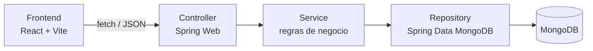

<div align="center">

# 🌱 EcoTrack

**Plataforma para descarte responsável e localização de pontos de coleta**


*AEP 2026.2 · 6º semestre de Engenharia de Software · UniCesumar*

</div>

---

## Índice

- [O problema](#o-problema)
- [ODS 12 — Consumo e Produção Responsáveis](#ods-12--consumo-e-produção-responsáveis)
- [Funcionalidades](#funcionalidades)
- [Arquitetura](#arquitetura)
- [Modelagem do banco (MongoDB)](#modelagem-do-banco-mongodb)
- [Tecnologias e por quê](#tecnologias-e-por-quê)
- [Como executar](#como-executar)
- [Como testar e gerar a cobertura](#como-testar-e-gerar-a-cobertura)
- [Documentação](#documentação)
- [Demonstração](#demonstração)
- [Equipe](#equipe)
- [Versão desta entrega](#versão-desta-entrega)
- [Licença](#licença)

---

## O problema

Muitas pessoas têm em casa resíduos como pilhas, eletrônicos, óleo de cozinha usado, plástico
e papel, mas não sabem onde descartá-los corretamente. A informação sobre pontos de coleta
costuma estar espalhada, desatualizada ou simplesmente não existir de forma centralizada — o
que leva ao descarte incorreto (lixo comum) e ao desperdício de material que poderia ser
reciclado ou reaproveitado.

O EcoTrack existe para resolver esse problema de forma direta: mostrar, pra quem quer
descartar um material, quais pontos de coleta ativos aceitam aquele tipo de resíduo, e permitir
registrar o descarte pra manter um histórico. Do outro lado, administradores mantêm a lista de
pontos de coleta atualizada (cadastro, edição e desativação).

**Público-alvo:** moradores de Maringá-PR e região que querem descartar corretamente, e
administradores de ecopontos que mantêm essas informações.

## ODS 12 — Consumo e Produção Responsáveis

O EcoTrack está alinhado à **meta 12.5**: *"Até 2030, reduzir substancialmente a geração de
resíduos por meio da prevenção, redução, reciclagem e reúso."* A relação é direta —
facilitando a informação sobre onde descartar, o aplicativo remove a principal barreira prática
que leva ao descarte incorreto, incentivando hábitos de consumo e descarte mais conscientes.

## Funcionalidades

Da primeira entrega:

- [x] Cadastro de usuários e de pontos de coleta.
- [x] Listagem de pontos de coleta ativos, com filtro por tipo de material aceito.
- [x] Cadastro, atualização e desativação (soft delete) de pontos de coleta.
- [x] Registro de descarte, validando que o ponto está ativo e aceita o material informado.
- [x] Consulta do histórico de descartes de um usuário.

Da segunda entrega:

- [x] Filtro de pontos por cidade, junto ou separado do filtro por material. O select de cidade
  vem de `GET /api/pontos/cidades` (só cidades com ponto ativo).
- [x] Dashboard com o total de descartes e a quantidade por material e unidade.
- [x] Histórico mostra o ponto de coleta de cada descarte.
- [x] Edição de ponto de coleta na tela de admin.
- [x] Erro 400 de corpo inválido (JSON quebrado, material que não existe) no mesmo formato dos
  outros erros da API.

## Arquitetura



| Camada | Responsabilidade |
|---|---|
| **Controller** | Recebe DTO validado, chama o service, devolve a resposta. Nenhuma regra de negócio. |
| **Service** | Concentra toda a regra de negócio (ex.: só permite descarte se o ponto estiver ativo e aceitar o material). |
| **Domain** | Entidades com construtor validador e métodos de comportamento (`PontoColeta.aceita()`, `desativar()`; `Descarte.validarContra()`). |
| **Repository** | Interfaces do Spring Data. As consultas que o Spring não gera (agregação do dashboard e `distinct` das cidades) ficam em fragmentos próprios com `MongoTemplate`. |
| **GlobalExceptionHandler** | Único ponto que traduz exceção de domínio em código HTTP. |

Mais detalhes em [`docs/arquitetura.md`](docs/arquitetura.md).

## Modelagem do banco (MongoDB)

Três coleções. Os pontos têm endereço embutido e lista de materiais; o descarte guarda uma
lista de itens e referencia usuário e ponto **por id (texto, não `ObjectId`)**.

```json
// usuarios
{ "_id": "ObjectId", "nome": "Pedro", "email": "pedro@email.com", "criadoEm": "ISODate" }
```

```json
// pontos_coleta — endereco embutido + array de materiais
{ "_id": "ObjectId", "nome": "Eco Ponto Centro", "ativo": true,
  "endereco": { "rua": "Av. Brasil", "numero": "1200", "bairro": "Zona 01", "cidade": "Maringá", "estado": "PR" },
  "materiaisAceitos": ["PILHAS", "ELETRONICOS", "PLASTICO"], "criadoEm": "ISODate" }
```

```json
// descartes — itens embutidos + referencias por id + nomes copiados
{ "_id": "ObjectId", "usuarioId": "string (ref usuarios)", "usuarioNome": "Joao Silva",
  "pontoColetaId": "string (ref pontos_coleta)", "pontoColetaNome": "Eco Ponto Centro",
  "data": "ISODate", "materiais": [ { "tipo": "PILHAS", "quantidade": 5, "unidade": "UNIDADE" } ] }
```

O que foi decidido e por quê:

- **Referência com cópia dos nomes** (Extended Reference): o descarte guarda `usuarioNome` e
  `pontoColetaNome` pra mostrar o histórico sem segunda consulta. Descartes antigos não têm os
  nomes (vêm `null`).
- **Índices criados pela aplicação** (`auto-index-creation`): `usuarios.email` (único),
  `descartes` por `usuarioId` + `data` (decrescente), `pontos_coleta` por `ativo` + `materiaisAceitos`
  e por `ativo` + `endereco.cidade`. A ordem segue a regra ESR e o `explain` mostra `IXSCAN` sem
  ordenação em memória.
- **Validação de esquema no banco** (`$jsonSchema`) nas três coleções, além da validação da API.
- **Agregação** (`$unwind` + `$group`) para o dashboard, somando por material **e** unidade, e
  `distinct` para a lista de cidades.

Detalhes, `explain` e consultas prontas em [`docs/modelagem-nosql.md`](docs/modelagem-nosql.md) e
[`docs/consultas-mongosh.js`](docs/consultas-mongosh.js).

## Tecnologias e por quê

| Tecnologia | Por quê |
|---|---|
| Java 21 + Spring Boot | Linguagem orientada a objetos, aplicando o paradigma na prática (disciplina de Paradigmas de Linguagem) |
| MongoDB | Banco NoSQL com documentos aninhados e arrays, atendendo aos requisitos de Banco de Dados NoSQL |
| Spring Data MongoDB | Gera as consultas a partir da interface do repositório; `MongoTemplate` onde precisa de agregação |
| JUnit 5 + Mockito + AssertJ | Testes de domínio, service e controller (disciplina de Testes de Software) |
| Testcontainers | Testes de repositório, índices e esquema contra um MongoDB de verdade |
| JaCoCo | Mede e garante a cobertura mínima de 70% a cada entrega |
| springdoc-openapi (Swagger) | Documentação e teste manual dos endpoints |
| React + Vite + TypeScript | Interface para demonstrar o fluxo completo de ponta a ponta |
| Vitest + Testing Library | Testes das telas, com a API mockada |
| GitHub Actions | CI que roda `./mvnw verify` (backend) e `npm test` + `npm run build` (front) a cada push/PR |

## Como executar

Pré-requisitos: **Java 21**, **Docker**, **Node 20 ou mais novo**.

```bash
# 1. Sobe o MongoDB
docker compose up -d

# 2. Backend (com dados de exemplo)
cd backend
./mvnw spring-boot:run -Dspring-boot.run.profiles=seed

# 3. Frontend (em outro terminal)
cd frontend
cp .env.example .env
npm install
npm run dev
```

| Serviço | URL |
|---|---|
| API | `http://localhost:8080` |
| Swagger UI | `http://localhost:8080/swagger-ui.html` |
| Frontend | `http://localhost:5173` |

O seed só grava se o banco estiver vazio (8 pontos em Maringá, Sarandi e Paicandu e 10
descartes). Se o banco `ecotrack` já tinha dados da entrega 1, apague ele antes pra ver as
cidades novas e os nomes nos descartes.

> **Atenção:** o `pom.xml` está fixado no Spring Boot 3.3.4. Compile com **Java 21** —
> versões mais novas da JDK não são compatíveis com a versão do JaCoCo usada no projeto.
> Só um MongoDB pode usar a porta 27017 (o do `docker compose` ou um `mongod` local).

## Como testar e gerar a cobertura

```bash
# backend (precisa do Docker rodando: alguns testes sobem um MongoDB)
cd backend
./mvnw verify

# frontend
cd frontend
npm test
```

Hoje são **95 testes no backend** e **6 no front**. O JaCoCo mede **92% das linhas e 87% dos
branches** (o `verify` falha abaixo de 70%). O relatório fica em
`backend/target/site/jacoco/index.html`. Print da medição em
[`docs/cobertura-entrega2.png`](docs/cobertura-entrega2.png).

**Exclusões do JaCoCo** (justificativa): `EcotrackApplication` (classe de bootstrap, sem lógica
de negócio), pacote `config` (beans de infraestrutura — conexão, CORS, OpenAPI, seed e o esquema
do Mongo; o esquema é testado à parte contra um MongoDB real) e pacote `dto` (records de
validação de entrada, sem comportamento próprio).

## Documentação

| Documento | O que tem |
|---|---|
| [`docs/produto.md`](docs/produto.md) | Visão, personas, requisitos, regras de negócio e histórias de usuário |
| [`docs/manual-usuario.md`](docs/manual-usuario.md) | Passo a passo de cada tela, com prints |
| [`docs/api.md`](docs/api.md) | Rotas, filtros, formato de erro e exemplos |
| [`docs/modelagem-nosql.md`](docs/modelagem-nosql.md) | Modelagem, índices, esquema, agregação e `explain` |
| [`docs/decisoes.md`](docs/decisoes.md) | Decisões de arquitetura (ADRs) |
| [`docs/arquitetura.md`](docs/arquitetura.md) | Camadas e responsabilidades |
| [`CHANGELOG.md`](CHANGELOG.md) | O que mudou da entrega 1 pra entrega 2 |

## Demonstração

Prints de cada tela no [manual do usuário](docs/manual-usuario.md). Vídeo: _[link aqui após gravar]_

## Equipe

| RA | Nome | Frente |
|---|---|---|
| — | Danilo | Modelagem do MongoDB (índices, agregação, distinct), regras de negócio e services |
| — | Pedro | Dashboard e filtros na API, telas do front (dashboard, cidade, edição), testes de tela e docs de API e manual |
| — | Talis | Testes com MongoDB real, validação de esquema, docs de modelagem, produto e decisões |

## Versão desta entrega

`v2.0.0-entrega2` — veja o [`CHANGELOG.md`](CHANGELOG.md).

## Licença

Distribuído sob a licença MIT. Veja [`LICENSE`](LICENSE) para mais detalhes.
