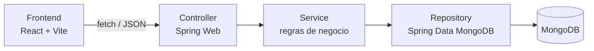

<div align="center">

# 🌱 EcoTrack

**Plataforma para descarte responsável e localização de pontos de coleta**


*AEP 2026.2 · 6º semestre de Engenharia de Software · UniCesumar*

</div>

---

## Índice

- [O problema](#o-problema)
- [ODS 12 — Consumo e Produção Responsáveis](#ods-12--consumo-e-produção-responsáveis)
- [Funcionalidades da primeira entrega](#funcionalidades-da-primeira-entrega)
- [Arquitetura](#arquitetura)
- [Modelagem do banco (MongoDB)](#modelagem-do-banco-mongodb)
- [Tecnologias e por quê](#tecnologias-e-por-quê)
- [Como executar](#como-executar)
- [Como testar e gerar a cobertura](#como-testar-e-gerar-a-cobertura)
- [Demonstração](#demonstração)
- [Equipe](#equipe)
- [Versão desta entrega](#versão-desta-entrega)
- [Roadmap — Segunda Entrega](#roadmap--segunda-entrega)
- [Licença](#licença)

---

## O problema

Muitas pessoas têm em casa resíduos como pilhas, eletrônicos, óleo de cozinha usado, plástico
e papel, mas não sabem onde descartá-los corretamente. A informação sobre pontos de coleta
costuma estar espalhada, desatualizada ou simplesmente não existir de forma centralizada — o
que leva ao descarte incorreto (lixo comum) e ao desperdício de material que poderia ser
reciclado ou reaproveitado.

O EcoTrack existe para resolver esse problema de forma direta: mostrar, pra quem quer
descartar um material, quais pontos de coleta ativos aceitam aquele tipo de resíduo, e permitir
registrar o descarte pra manter um histórico. Do outro lado, administradores mantêm a lista de
pontos de coleta atualizada (cadastro, edição e desativação).

**Público-alvo:** moradores de Maringá-PR e região que querem descartar corretamente, e
administradores de ecopontos que mantêm essas informações.

## ODS 12 — Consumo e Produção Responsáveis

O EcoTrack está alinhado à **meta 12.5**: *"Até 2030, reduzir substancialmente a geração de
resíduos por meio da prevenção, redução, reciclagem e reúso."* A relação é direta —
facilitando a informação sobre onde descartar, o aplicativo remove a principal barreira prática
que leva ao descarte incorreto, incentivando hábitos de consumo e descarte mais conscientes.

## Funcionalidades da primeira entrega

- [x] Cadastro de usuários e de pontos de coleta.
- [x] Listagem de pontos de coleta ativos, com filtro por tipo de material aceito.
- [x] Cadastro, atualização e desativação (soft delete) de pontos de coleta.
- [x] Registro de descarte, validando que o ponto está ativo e aceita o material informado.
- [x] Consulta do histórico de descartes de um usuário.
- [x] Interface web com 4 telas cobrindo o fluxo completo.

## Arquitetura



| Camada | Responsabilidade |
|---|---|
| **Controller** | Recebe DTO validado, chama o service, devolve a resposta. Nenhuma regra de negócio. |
| **Service** | Concentra toda a regra de negócio (ex.: só permite descarte se o ponto estiver ativo e aceitar o material). |
| **Domain** | Entidades com construtor validador e métodos de comportamento (`PontoColeta.aceita()`, `desativar()`; `Descarte.validarContra()`). |
| **Repository** | Interfaces do Spring Data — sem implementação manual de query. |
| **GlobalExceptionHandler** | Único ponto que traduz exceção de domínio em código HTTP. |

Mais detalhes em [`docs/arquitetura.md`](docs/arquitetura.md).

## Modelagem do banco (MongoDB)

Três coleções, com relacionamento por referência e pelo menos uma coleção com documentos
aninhados/listas de subdocumentos:

```json
// usuarios
{ "_id": "ObjectId", "nome": "Pedro", "email": "pedro@email.com", "criadoEm": "ISODate" }
```

```json
// pontos_coleta — endereco aninhado + array de materiais
{ "_id": "ObjectId", "nome": "Eco Ponto Centro", "ativo": true,
  "endereco": { "rua": "Av. Brasil", "numero": "1200", "bairro": "Zona 01", "cidade": "Maringá", "estado": "PR" },
  "materiaisAceitos": ["PILHAS", "ELETRONICOS", "PLASTICO"], "criadoEm": "ISODate" }
```

```json
// descartes — lista de itens + referencias por id
{ "_id": "ObjectId", "usuarioId": "ObjectId (ref usuarios)", "pontoColetaId": "ObjectId (ref pontos_coleta)",
  "data": "ISODate", "materiais": [ { "tipo": "PILHAS", "quantidade": 5, "unidade": "UNIDADE" } ] }
```

**Índices:** `usuarios.email` (único) · `pontos_coleta.materiaisAceitos` · `descartes.usuarioId`

Detalhes completos em [`docs/modelagem-nosql.md`](docs/modelagem-nosql.md).

## Tecnologias e por quê

| Tecnologia | Por quê |
|---|---|
| Java 21 + Spring Boot | Linguagem orientada a objetos, aplicando o paradigma na prática (disciplina de Paradigmas de Linguagem) |
| MongoDB | Banco NoSQL com documentos aninhados e arrays, atendendo aos requisitos de Banco de Dados NoSQL |
| Spring Data MongoDB | Gera as consultas a partir da interface do repositório, sem SQL/queries manuais |
| JUnit 5 + Mockito + AssertJ | Testes de domínio, service e controller (disciplina de Testes de Software) |
| JaCoCo | Mede e garante a cobertura mínima de 70% a cada entrega |
| springdoc-openapi (Swagger) | Documentação e teste manual dos endpoints |
| React + Vite + TypeScript | Interface para demonstrar o fluxo completo de ponta a ponta |
| GitHub Actions | CI que roda `./mvnw verify` a cada push/PR |

## Como executar

Pré-requisitos: **Java 21**, **Docker**, **Node 20**.

```bash
# 1. Sobe o MongoDB
docker compose up -d

# 2. Backend (com dados de exemplo)
cd backend
./mvnw spring-boot:run -Dspring-boot.run.profiles=seed

# 3. Frontend (em outro terminal)
cd frontend
npm install
npm run dev
```

| Serviço | URL |
|---|---|
| API | `http://localhost:8080` |
| Swagger UI | `http://localhost:8080/swagger-ui.html` |
| Frontend | `http://localhost:5173` |

> **Atenção:** o `pom.xml` está fixado no Spring Boot 3.3.4. Compile com **Java 21** —
> versões mais novas da JDK não são compatíveis com a versão do JaCoCo usada no projeto.

## Como testar e gerar a cobertura

```bash
cd backend
./mvnw verify
```

O relatório do JaCoCo fica em `backend/target/site/jacoco/index.html`. Print da última medição
em [`docs/cobertura-entrega1.png`](docs/cobertura-entrega1.png).

**Exclusões do JaCoCo** (justificativa): `EcotrackApplication` (classe de bootstrap, sem lógica
de negócio), pacote `config` (beans de infraestrutura — conexão, CORS, OpenAPI — sem regra pra
testar) e pacote `dto` (records de validação de entrada, sem comportamento próprio).

## Demonstração

_[Prints do Swagger e das 4 telas — adicionar após a gravação do vídeo.]_

## Equipe

| RA | Nome | Frente |
|---|---|---|
| — | Danilo | Domínio, regras de negócio e services do backend |
| — | Pedro | Camada web do backend (DTOs, mappers, controllers) e frontend completo |
| — | Thales | Banco de dados, testes automatizados, CI e documentação |

## Versão desta entrega

`v1.0.0-entrega1` — vídeo de demonstração: _[link aqui após gravar]_

## Roadmap — Segunda Entrega

- Dashboard com totais e indicadores por material/período.
- Filtros adicionais (cidade, status).
- Testes de repositório com banco real.
- Documentação técnica completa e melhorias visuais no frontend.

## Licença

Distribuído sob a licença MIT. Veja [`LICENSE`](LICENSE) para mais detalhes.
