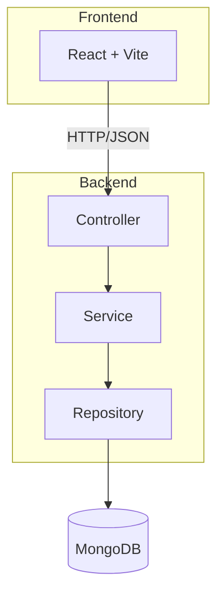
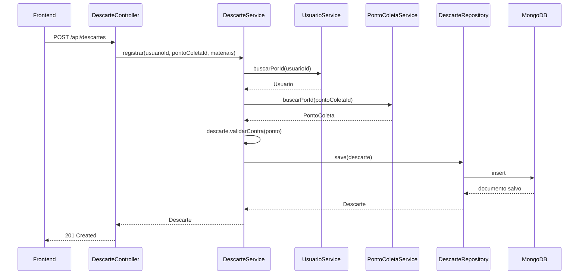

# Arquitetura

## Camadas

- **Controller**: recebe DTO validado, chama service, devolve resposta. Nenhuma regra de
  negócio.
- **Service**: concentra toda a regra de negócio, orquestra repositórios e entidades.
- **Domain (entidades)**: construtor validador + métodos de comportamento
  (`aceita`, `desativar`, `validarContra`).
- **Repository**: interfaces `MongoRepository`, sem implementação manual.
- **GlobalExceptionHandler**: única classe que traduz exceção de domínio em código HTTP.

## Fluxo de uma requisição (exemplo: registrar descarte)

Se `validarContra` lançar `RegraDeNegocioException` (ponto inativo ou material não aceito), o
`GlobalExceptionHandler` intercepta e devolve `422 Unprocessable Entity` com corpo padronizado
(`timestamp`, `status`, `erro`, `mensagem`, `caminho`).

## Por que essas decisões

- **Sem MapStruct**: os mappers são métodos estáticos simples porque o número de campos é
  pequeno — uma biblioteca de mapeamento adicionaria complexidade sem ganho real aqui.
- **Sem `@DBRef`**: referências entre coleções são `String` (o id), não referência nativa do
  Mongo. Isso evita que o Spring Data busque automaticamente documentos relacionados quando não
  é necessário (custo de performance) e mantém o controle explícito de quando buscar cada
  entidade (via os services).
- **Services concentram a regra, não os controllers**: permite testar toda a regra de negócio
  com Mockito, sem precisar subir o contexto web inteiro.
