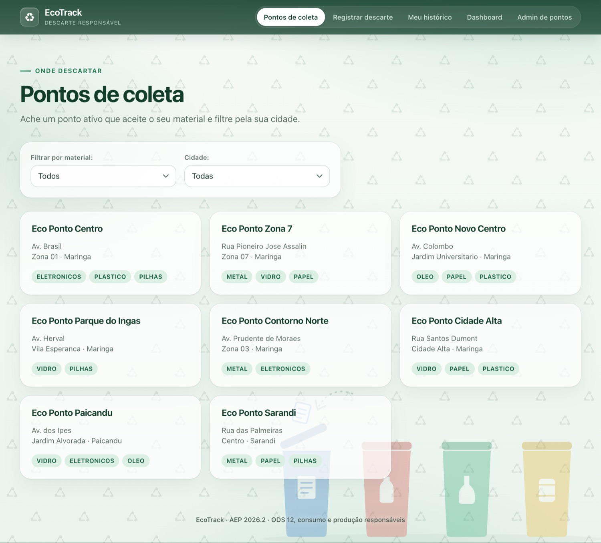
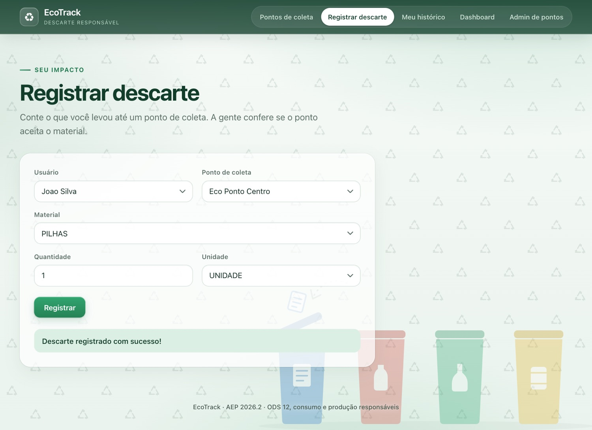
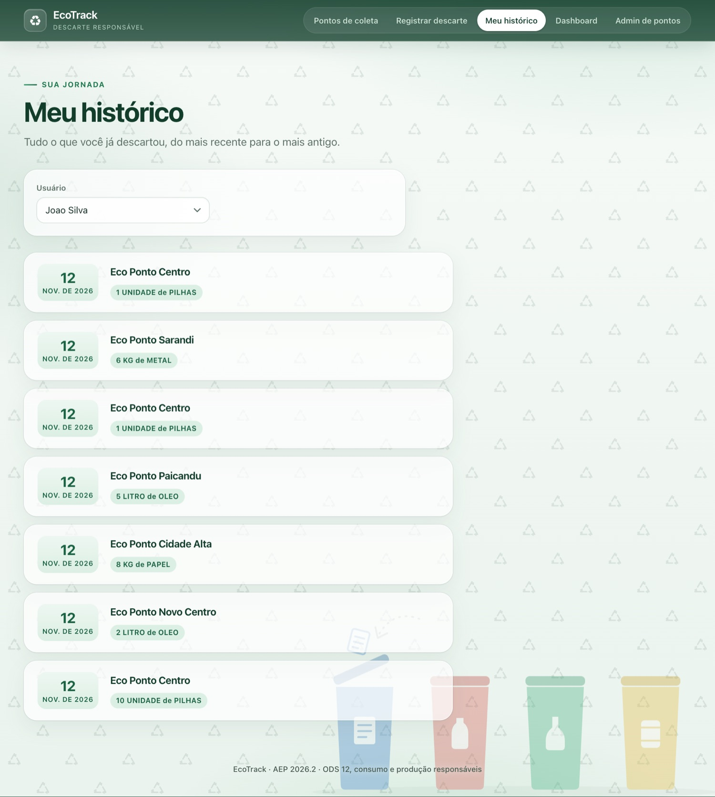
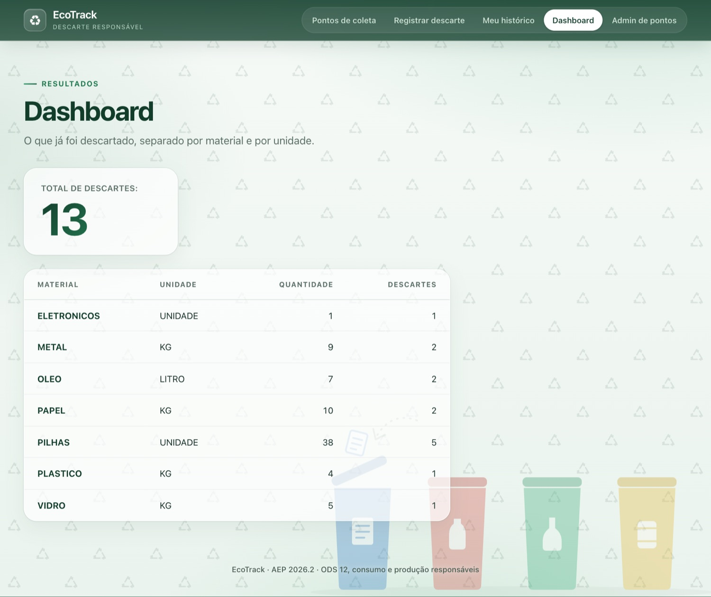
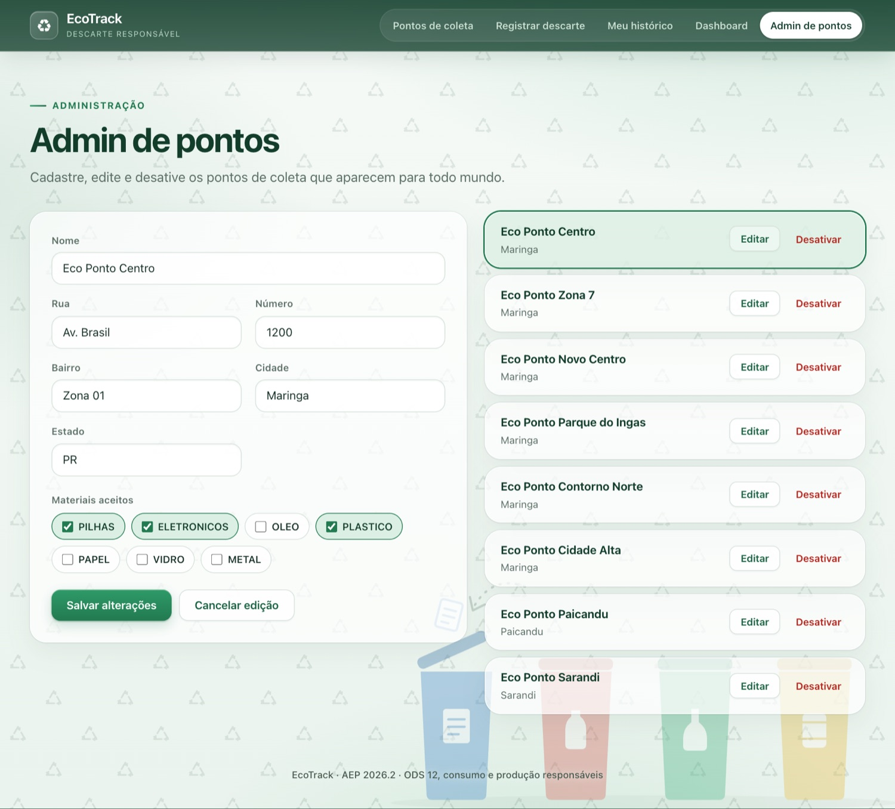

# Manual do usuário — EcoTrack

O EcoTrack ajuda você a descobrir onde descartar pilhas, eletrônicos, óleo, plástico, papel, vidro e metal, e guarda o histórico do que já descartou. Não precisa de login.

## Pontos de coleta



1. Abra a tela inicial: ela lista os pontos ativos.
2. Para achar onde descartar um material, escolha ele em **Filtrar por material**.
3. Para ver só uma cidade, escolha em **Cidade**. Os dois filtros funcionam juntos.

## Registrar descarte



1. Escolha o **usuário** e o **ponto de coleta**.
2. Escolha o **material**, a **quantidade** e a **unidade** (unidade, kg ou litro).
3. Clique em **Registrar**.
4. Se deu certo aparece "Descarte registrado com sucesso!".
5. Se o ponto não aceita aquele material, aparece o erro 422 com o motivo. Escolha outro ponto ou outro material.

## Meu histórico



Escolha o usuário. Aparece cada descarte com a data, o ponto onde foi feito e o que foi descartado, do mais recente para o mais antigo. Descartes antigos, de antes do ponto ser guardado, aparecem como "ponto não informado".

## Dashboard



Mostra quantos descartes já foram registrados e a quantidade total por material. A quantidade é separada por unidade: o que foi em kg não é somado com o que foi em litro.

## Admin de pontos



- **Cadastrar:** preencha nome, endereço e marque os materiais que o ponto aceita (pelo menos um). Clique em **Cadastrar ponto**.
- **Editar:** clique em **Editar** ao lado do ponto, mude o que precisar e clique em **Salvar alterações**. **Cancelar edição** volta ao formulário vazio.
- **Desativar:** clique em **Desativar**. O ponto não some do banco, só deixa de aparecer nas listas e de receber descartes.

## Como subir o sistema

```bash
docker compose up -d
cd backend && ./mvnw spring-boot:run -Dspring-boot.run.profiles=seed
cd frontend && cp .env.example .env && npm install && npm run dev
```

Abra `http://localhost:5173`.
