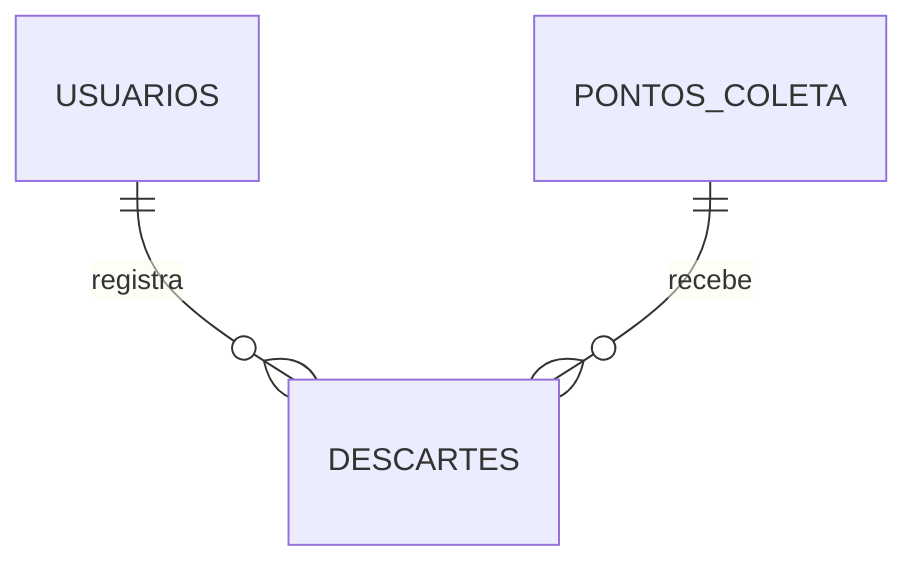

# Modelagem NoSQL

## Coleções

### `usuarios`

```json
{ "_id": "ObjectId", "nome": "Pedro", "email": "pedro@email.com", "criadoEm": "ISODate" }
```

### `pontos_coleta`

```json
{ "_id": "ObjectId", "nome": "Eco Ponto Centro", "ativo": true,
  "endereco": { "rua": "Av. Brasil", "numero": "1200", "bairro": "Zona 01", "cidade": "Maringá", "estado": "PR" },
  "materiaisAceitos": ["PILHAS", "ELETRONICOS", "PLASTICO"], "criadoEm": "ISODate" }
```

### `descartes`

```json
{ "_id": "ObjectId", "usuarioId": "ObjectId (ref usuarios)", "pontoColetaId": "ObjectId (ref pontos_coleta)",
  "data": "ISODate", "materiais": [ { "tipo": "PILHAS", "quantidade": 5, "unidade": "UNIDADE" } ] }
```

## Relacionamentos



Referências por `String` (id), sem `@DBRef` — decisão da equipe pra manter simples e
performático (evita que o Spring Data busque automaticamente documentos relacionados quando não
é necessário).

## Por que atende ao nível de 2º semestre desde a primeira entrega

O enunciado da AEP deixa em aberto qual nível de modelagem (1º ou 2º semestre) se aplica ao 6S.
Para não correr risco, o EcoTrack já usa, desde a Entrega 1:

- **Múltiplas coleções** (`usuarios`, `pontos_coleta`, `descartes`) — não uma única coleção.
- **Relacionamento entre coleções** — `descartes` referencia `usuarios` e `pontos_coleta` por id.
- **Documentos complexos** — `pontos_coleta` tem `endereco` aninhado; `descartes` tem uma lista
  de subdocumentos (`materiais`).

## Índices

Criados/gerenciados pelo Spring Data a partir das anotações nas entidades:

| Coleção | Campo | Tipo | Por quê |
|---|---|---|---|
| `usuarios` | `email` | único (`@Indexed(unique = true)`) | Impede dois usuários com o mesmo e-mail; suporta a checagem de duplicidade no cadastro. |
| `pontos_coleta` | `materiaisAceitos` | simples (`@Indexed`) | Acelera o filtro `GET /api/pontos?material=X`, a operação de busca mais usada da PoC. |
| `descartes` | `usuarioId` | simples (`@Indexed`) | Acelera a consulta de histórico (`GET /api/descartes/usuario/{id}`), ordenada por data. |

## Como validar no MongoDB Compass

1. Conecte em `mongodb://localhost:27017/ecotrack`.
2. Suba o backend com o perfil `seed` (`./mvnw spring-boot:run -Dspring-boot.run.profiles=seed`).
3. As 3 coleções aparecem populadas: 3 usuários, 6 pontos de coleta, 8 descartes.
4. Abra um documento de `pontos_coleta` pra ver o `endereco` aninhado e o array
   `materiaisAceitos`; abra um documento de `descartes` pra ver a lista `materiais`.
