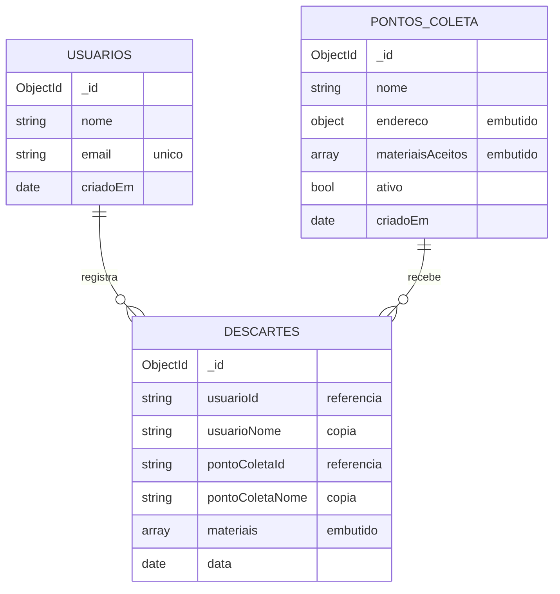

# Modelagem NoSQL — EcoTrack

Banco: MongoDB 7, no banco `ecotrack`. Três coleções. Esta página explica o que está em cada uma, **por que cada decisão foi tomada** e como provamos que os índices funcionam.

## Visão geral



O Spring Data também grava em cada documento o campo `_class` (nome da classe Java). Ele não faz parte do modelo, é só do mapeamento.

## Os documentos (reais, tirados do seed)

`usuarios`:

```json
{
  "_id": { "$oid": "6af5ae925ccdf046d8b9b654" },
  "nome": "Joao Silva",
  "email": "joao@email.com",
  "criadoEm": { "$date": "2026-11-12T12:18:26.200Z" },
  "_class": "br.com.ecotrack.domain.model.Usuario"
}
```

`pontos_coleta` (endereço e materiais **dentro** do documento):

```json
{
  "_id": { "$oid": "6af5ae925ccdf046d8b9b657" },
  "nome": "Eco Ponto Centro",
  "endereco": { "rua": "Av. Brasil", "numero": "1200", "bairro": "Zona 01", "cidade": "Maringa", "estado": "PR" },
  "materiaisAceitos": ["PLASTICO", "PILHAS", "ELETRONICOS"],
  "ativo": true,
  "criadoEm": { "$date": "2026-11-12T12:18:26.218Z" },
  "_class": "br.com.ecotrack.domain.model.PontoColeta"
}
```

`descartes` (lista de itens dentro do documento, referências por id em texto e nomes copiados):

```json
{
  "_id": { "$oid": "6af5ae925ccdf046d8b9b667" },
  "usuarioId": "6af5ae925ccdf046d8b9b656",
  "usuarioNome": "Pedro Santos",
  "pontoColetaId": "6af5ae925ccdf046d8b9b65d",
  "pontoColetaNome": "Eco Ponto Sarandi",
  "materiais": [
    { "tipo": "PILHAS", "quantidade": 6, "unidade": "UNIDADE" },
    { "tipo": "PAPEL", "quantidade": 2, "unidade": "KG" }
  ],
  "data": { "$date": "2026-11-12T12:18:26.240Z" },
  "_class": "br.com.ecotrack.domain.model.Descarte"
}
```

## Embutir ou referenciar? Decisão por campo

A regra usada: **embutir** o que nasce, vive e é lido junto com o documento pai e tem tamanho pequeno e limitado. **Referenciar** o que tem vida própria ou cresce sem limite.

| Dado | Decisão | Por quê |
|---|---|---|
| `endereco` do ponto | Embutido | Relação 1:1, sempre lido junto com o ponto, não existe sozinho |
| `materiaisAceitos` do ponto | Embutido (array) | No máximo 7 valores, lido junto, e o filtro por material usa índice sobre o array |
| `materiais` do descarte | Embutido (lista de subdocumentos) | Os itens só existem dentro do descarte e são sempre lidos com ele |
| `usuarioId` e `pontoColetaId` no descarte | Referência (por id, em texto) | Usuário e ponto existem sem nenhum descarte e são editados de forma independente |
| Descartes **dentro** do usuário | **Não embutido** | Um usuário pode ter descartes sem limite: o array cresceria para sempre (anti-padrão de array ilimitado) |

Sem `@DBRef`: a referência é só o id em texto. A integridade (usuário e ponto precisam existir) é conferida no `DescarteService`, porque o Mongo não garante isso.

## Padrões de modelagem usados

**Extended Reference.** O descarte guarda uma cópia do nome do usuário e do nome do ponto no momento em que foi feito. Ganhos: o histórico mostra onde o descarte aconteceu sem buscar outra coleção, e continua correto mesmo se o ponto for renomeado ou desativado depois. Custo: duplicação do dado (aceito de propósito, porque é um registro histórico). O padrão é descrito pela própria MongoDB em *Building with Patterns*.

**Computed (não usado, e sabemos por quê).** O dashboard calcula os totais na hora, com uma agregação. Para o volume da PoC isso é simples e sempre correto. Com milhões de descartes o caminho seria guardar totais pré-calculados e atualizá-los a cada descarte, trocando simplicidade por trabalho extra na escrita.

## Índices

Criados automaticamente a partir das anotações nas entidades (`spring.data.mongodb.auto-index-creation: true`).

| Coleção | Índice | Chaves | Atende |
|---|---|---|---|
| `usuarios` | `email` | `{ email: 1 }` único | Impede e-mail repetido, mesmo fora da aplicação |
| `pontos_coleta` | `ativo_materiais` | `{ ativo: 1, materiaisAceitos: 1 }` | Pontos ativos que aceitam um material (índice multikey por ser array) |
| `pontos_coleta` | `ativo_cidade` | `{ ativo: 1, "endereco.cidade": 1 }` | Pontos ativos de uma cidade |
| `descartes` | `usuario_data` | `{ usuarioId: 1, data: -1 }` | Histórico do usuário, do mais recente para o mais antigo |

**Regra ESR (Equality, Sort, Range).** Em índice composto, as chaves de igualdade vêm primeiro, depois as de ordenação, depois as de intervalo. No `usuario_data`, `usuarioId` é igualdade e `data` é ordenação: o Mongo acha os descartes do usuário **já na ordem certa**, sem ordenar em memória.

A busca por cidade é **exata** (com a escrita cadastrada). É de propósito: busca sem diferenciar maiúscula não aproveita o índice. Por isso o filtro da tela é um select montado a partir de `GET /api/pontos/cidades`, que usa `distinct`.

### Evidência (`explain` com o seed: 8 pontos e 10 descartes)

| Consulta | Plano | Índice usado | Documentos examinados | Retornados | Ordenação em memória |
|---|---|---|---|---|---|
| Histórico de um usuário, ordenado por data | IXSCAN | `usuario_data` | 4 | 4 | não |
| Pontos ativos com PILHAS | IXSCAN | `ativo_materiais` | 3 | 3 | não |
| Pontos ativos em Sarandi | IXSCAN | `ativo_cidade` | 1 | 1 | não |

Com volume pequeno a diferença de tempo não aparece. O que o `explain` prova é o **plano**: examina só o que devolve. Sem o índice seria `COLLSCAN`, lendo a coleção toda. Os testes `IndicesMongoIntegracaoTest` repetem essa verificação automaticamente.

## Validação de esquema (`$jsonSchema`)

Além da validação em Java, cada coleção tem um *validator* no próprio Mongo, aplicado quando a aplicação sobe (`validationLevel: moderate`, `validationAction: error`).

| Coleção | Regras |
|---|---|
| `usuarios` | `nome` e `email` obrigatórios; `email` com formato de e-mail |
| `pontos_coleta` | `nome`, `endereco` (com `rua`, `cidade` e `estado`), `materiaisAceitos` e `ativo` obrigatórios; `materiaisAceitos` com pelo menos 1 item, sem repetir, só valores do enum de materiais |
| `descartes` | Nomes e ids obrigatórios; `materiais` com pelo menos 1 item; cada item com `tipo` e `unidade` válidos e `quantidade` inteira maior ou igual a 1 |

`moderate` é intencional: descartes gravados antes da entrega 2 não têm os nomes e continuam no banco; só o que entra novo é validado.

## Agregação do dashboard

O total por material é feito dentro do Mongo, sem trazer os descartes para o Java:

```js
db.descartes.aggregate([
  { $unwind: "$materiais" },
  { $group: {
      _id: { tipo: "$materiais.tipo", unidade: "$materiais.unidade" },
      quantidade: { $sum: "$materiais.quantidade" },
      descartes: { $sum: 1 }
  } },
  { $sort: { "_id.tipo": 1, "_id.unidade": 1 } }
])
```

Agrupa por **material e unidade**, porque somar kg com litro não faz sentido. Resultado com o seed (trecho):

```json
[
  { "_id": { "tipo": "ELETRONICOS", "unidade": "UNIDADE" }, "quantidade": 1, "descartes": 1 },
  { "_id": { "tipo": "METAL", "unidade": "KG" }, "quantidade": 3, "descartes": 1 },
  { "_id": { "tipo": "OLEO", "unidade": "LITRO" }, "quantidade": 7, "descartes": 2 }
]
```

Essa agregação lê a coleção inteira a cada chamada (não há filtro). Para a PoC é suficiente.

## Limitações conhecidas

- **Nomes duplicados no descarte** podem ficar diferentes do cadastro atual: é o comportamento esperado de um histórico.
- **Integridade referencial** fica na aplicação, não no banco.
- **Descartes antigos** (anteriores à entrega 2) vêm sem `usuarioNome` e `pontoColetaNome`.
- **Dashboard** recalcula tudo a cada chamada (ver *Computed* acima).
- **Cidade** só filtra por escrita exata.

## Como reproduzir

```bash
mongosh "mongodb://localhost:27017/ecotrack" --file docs/consultas-mongosh.js
```
