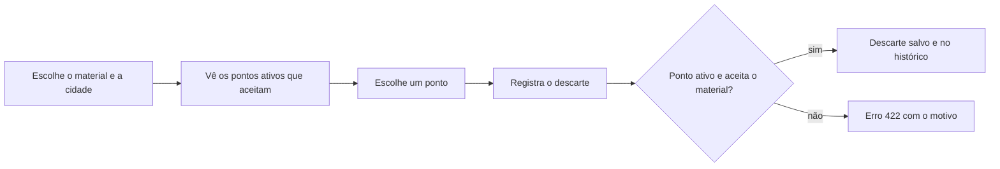

# Produto — EcoTrack

## Visão

O EcoTrack ajuda pessoas a descobrir **onde descartar corretamente** pilhas, eletrônicos, óleo, plástico, papel, vidro e metal, e registra o que cada pessoa já descartou. Quem mantém os pontos de coleta cadastra, atualiza e desativa os pontos.

Alinhado ao **ODS 12 — Consumo e Produção Responsáveis**, meta 12.5: reduzir a geração de resíduos por prevenção, redução, reciclagem e reúso. A barreira que o produto ataca é prática: a informação sobre pontos de coleta é espalhada, e sem ela o material vira lixo comum.

## Quem usa (personas ilustrativas)

**Marina, 34 anos, moradora de Maringá.** Tem pilhas e um celular velho em casa e não sabe onde levar. Quer achar um ponto perto que aceite o que ela tem e lembrar o que já descartou.

**Carlos, administrador de um ecoponto.** Precisa manter a lista de pontos atualizada: cadastrar um ponto novo, corrigir um endereço, mudar os materiais que aceita e tirar da lista um ponto que fechou.

## Escopo

Dentro: cadastro de usuários e pontos, busca de pontos por material e cidade, registro de descarte com validação, histórico por usuário, dashboard com totais.

Fora (decisão consciente da PoC): autenticação e senha, mapa e geolocalização, pagamentos, ranking e gamificação. Por isso a tela de admin é aberta: não há controle de acesso.

## Requisitos funcionais

| Id | Requisito |
|---|---|
| RF01 | Cadastrar usuário com nome e e-mail único |
| RF02 | Listar usuários |
| RF03 | Cadastrar ponto de coleta com endereço e pelo menos um material aceito |
| RF04 | Listar pontos ativos, filtrando por material e por cidade (juntos ou separados) |
| RF05 | Listar as cidades que têm ponto ativo |
| RF06 | Editar nome, endereço e materiais de um ponto |
| RF07 | Desativar um ponto (sem apagar) |
| RF08 | Registrar um descarte de um usuário em um ponto, com um ou mais itens (material, quantidade, unidade) |
| RF09 | Consultar o histórico de descartes de um usuário, do mais recente para o mais antigo |
| RF10 | Mostrar o dashboard: total de descartes e total por material e unidade |
| RF11 | Informar se a API e o banco estão no ar |

## Requisitos não funcionais

| Id | Requisito |
|---|---|
| RNF01 | Dados em banco NoSQL (MongoDB), com índices para as consultas principais |
| RNF02 | Erros da API em formato único: `timestamp`, `status`, `erro`, `mensagem`, `caminho` |
| RNF03 | Cobertura de testes automatizados de pelo menos 70%, verificada no CI |
| RNF04 | Dados inválidos recusados também pelo banco (validação de esquema) |
| RNF05 | Documentação da API (Swagger) e do banco atualizadas junto com o código |

## Regras de negócio

| Id | Regra |
|---|---|
| RN01 | O e-mail do usuário é único (erro 409 ao repetir) |
| RN02 | Todo ponto tem endereço com rua, cidade e estado e aceita pelo menos um material |
| RN03 | Desativar não apaga: o ponto some das listas e **não recebe descartes** (erro 422) |
| RN04 | Só se descarta no ponto um material que ele aceita (erro 422) |
| RN05 | Usuário e ponto do descarte precisam existir (erro 404) |
| RN06 | Cada item do descarte tem material, unidade e quantidade maior ou igual a 1 |
| RN07 | O descarte guarda o nome do usuário e do ponto da hora em que foi feito: o histórico não muda se o cadastro mudar |
| RN08 | Os totais do dashboard são separados por unidade: kg não se soma com litro |

## Histórias de usuário

**US01 — Encontrar onde descartar (Marina).** Como moradora, quero filtrar os pontos pelo material que tenho, para saber onde levar.
- Dado que existem pontos que aceitam pilhas e pontos que não aceitam,
- Quando escolho PILHAS no filtro de material,
- Então vejo só os pontos ativos que aceitam pilhas.

**US02 — Filtrar por cidade (Marina).** Como moradora, quero ver só os pontos da minha cidade.
- Dado que há pontos em Maringá e em Sarandi,
- Quando escolho Sarandi no filtro de cidade,
- Então vejo só os pontos de Sarandi, e posso combinar com o material.

**US03 — Registrar descarte (Marina).** Como moradora, quero registrar o que descartei.
- Dado que escolhi um usuário e um ponto que aceita o material,
- Quando informo material, quantidade e unidade e registro,
- Então o descarte é salvo e aparece "Descarte registrado com sucesso!".

**US04 — Ser avisada do erro (Marina).** Como moradora, quero entender por que não consegui registrar.
- Dado que o ponto escolhido não aceita o material,
- Quando tento registrar,
- Então o sistema recusa e mostra o motivo (erro 422).

**US05 — Ver meu histórico (Marina).** Como moradora, quero ver o que já descartei e onde.
- Dado que fiz descartes em pontos diferentes,
- Quando escolho meu usuário no histórico,
- Então vejo cada descarte com data, ponto e itens, do mais recente para o mais antigo.

**US06 — Manter os pontos (Carlos).** Como administrador, quero cadastrar, editar e desativar pontos.
- Dado que estou na tela de admin,
- Quando cadastro, edito ou desativo um ponto,
- Então a lista de pontos reflete a mudança, e o ponto desativado deixa de aparecer para os usuários.

**US07 — Ver o impacto (Carlos).** Como administrador, quero ver quanto já foi descartado.
- Dado que existem descartes registrados,
- Quando abro o dashboard,
- Então vejo o total de descartes e a quantidade por material e unidade.

## Fluxo principal

## Glossário

| Termo | Significado |
|---|---|
| Ponto de coleta | Local que recebe materiais para descarte correto |
| Ativo / inativo | Ponto ativo aparece nas listas e recebe descartes. Inativo foi desativado (não é apagado) |
| Descarte | Registro de um usuário levando um ou mais itens a um ponto |
| Item | Um material com quantidade e unidade dentro de um descarte |
| Material | Pilhas, eletrônicos, óleo, plástico, papel, vidro ou metal |
| Unidade | Unidade, kg ou litro |
| Extended reference | Padrão de modelagem: guardar uma cópia de um dado do documento referenciado (aqui, os nomes) |
